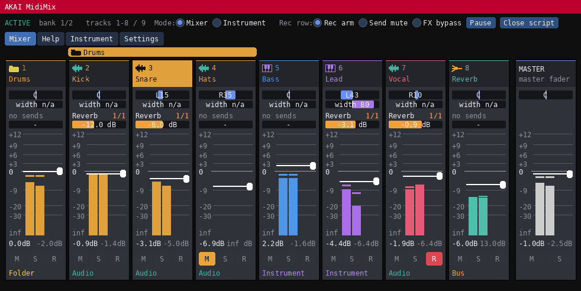
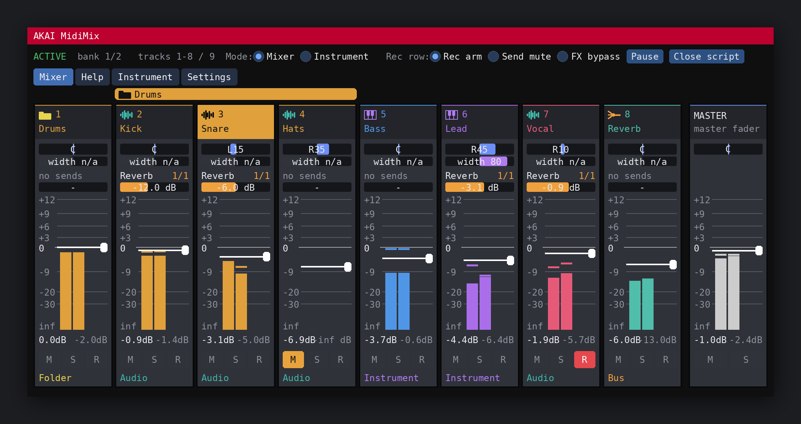
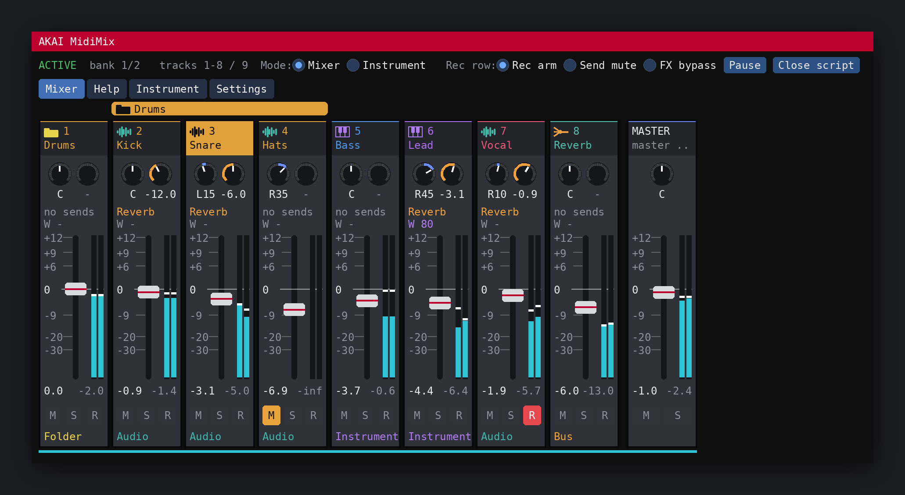

<p align="center">English | <a href="README.ru.md">Русский</a></p>

<h1 align="center">AKAI MidiMix for REAPER</h1>

<p align="center">
Turn your Akai MIDI Mix into a real REAPER mixer.<br>
One Lua script. No ReaLearn, no OSC, no extensions.
</p>

<p align="center">
  
</p>

Faders, knobs and buttons control your tracks, and the LEDs on the controller follow what happens in REAPER. A window shows the same mixer on screen, so you always see what the hardware is doing.

## What you get

**A real mixer on 24 knobs, 9 faders and 24 buttons**
- Faders set track volume. The top of the fader is +12 dB, like REAPER itself. The Master fader controls the master.
- Bottom knobs set pan, middle knobs set stereo width, top knobs set send levels.
- Mute, Solo and Rec arm for every strip.
- Soft takeover (pickup) everywhere: when you move a control, the value does not jump. Turn the knob until it reaches the current value and it takes over.
- Banks of up to 8 tracks. Bank Left and Bank Right page through your project, hold one to jump to the first or last bank, and Solo + Bank moves by one track.

**Master track on the device**
Hold Bank Right and press Mute or Solo for the master, or turn any bottom knob for master pan.

**Three jobs for the Rec row**
The Rec buttons can arm recording, mute the send shown in the window, or bypass the whole FX chain of a track. Double tap Solo to switch.

**Instrument mode**
All 24 knobs turn into plugin parameters. Click a cell in the window, touch a parameter in any plugin on any track (or the master), and the knob is mapped. Mappings are saved in your project. Mute opens the plugin window, Rec selects the track.

**Track types**
Audio, instrument, bus, VCA, folder and separator are found automatically. You can set a type by hand with one click. Separator tracks are skipped by the controller.

**See your bank in REAPER**
Mark the tracks you are controlling with spacers, two red marker tracks, or a red tint. Everything the script adds is removed when it stops.

**LEDs that tell the truth**
Mute and Rec follow the state of REAPER. The Bank LEDs show which page you are on and when the script is paused. There is a start-up animation and a blink on exit, and both can be turned off.

## The window

<p align="center">
  
  
</p>

Needs [ReaImGui](https://github.com/cfillion/reaimgui) (optional, the controller works without it).

- **Two looks.** Classic bars, or an MPC 2.0 style with round knobs. Switch in Settings.
- Stereo level meters with peak hold. They follow the fader and the pan, so a track panned right shows less on the left.
- A bright line marks 0 dB. The fader scale follows the fader top you choose.
- Folder bands over the strips, track colours, and the master strip.
- **Help tab** with every button combination. Rest the mouse on a pan bar, fader or button for a short hint.
- **Instrument tab** for mappings, **Settings tab** for everything else.
- English or Russian. The window title bar is Akai Red.

## Install

**With ReaPack (recommended)**
1. Extensions > ReaPack > Import repositories, and paste:
   `https://github.com/eighthkeepa/AKAI-MidiMix-for-REAPER/raw/main/index.xml`
2. Browse packages, search for "AKAI MidiMix", install **AKAI MidiMix for REAPER**.
3. Optional: install **ReaImGui** the same way, for the window.

**By hand**
1. Options > Show REAPER resource path, open `Scripts`, and copy the contents of the `MIDI/` folder there: `AKAI MidiMix.lua` and the `midimix/` folder next to it.

**Then**
1. Preferences > MIDI Devices: enable **input and output** for the MIDI Mix (output is needed for the LEDs).
2. Any track that records from "All MIDI inputs" will get the MIDI Mix notes. Change the input of such tracks.
3. Actions > Show action list > New action > Load ReaScript > `AKAI MidiMix.lua` > Run. Add it to a toolbar for an on/off button.

If a button or LED does not do what you expect, run **AKAI MidiMix probe**. It lights the LEDs one by one and prints what your device sends.

## Controls

| What | How |
|---|---|
| Volume | Faders (Master fader = master) |
| Pan / width / send | Bottom / middle / top knobs |
| Mute | Mute |
| Rec arm (or the current Rec row job) | Rec, acts on release |
| Solo one track | Hold Solo + that strip's Mute |
| Solo the whole bank | Solo, short tap (tap again to restore) |
| Rec for the whole bank | Solo + any Rec |
| Clear all solo | Solo + Send All |
| Previous / next bank | Bank Left / Bank Right |
| First / last bank | Hold Bank Left / Right for half a second, release |
| Move by one track | Solo + Bank |
| Master mute / solo / pan | Hold Bank Right + Mute / Solo / bottom knob |
| Next send of one track | Hold its Rec, tap Send All |
| Pause / resume | Send All, double tap |
| Change the Rec row job | Solo, double tap (the second tap also puts the bank's solo state back) |
| Instrument mode on / off | Send All, single tap |

The same list is in the **Help** tab of the window.

Send All sends no note, only a burst of CC messages, so it can do tap and double tap but not hold.

**Off by default:** the script never changes a track's pan mode on its own. If you want it to, turn on "Allow switching tracks to stereo pan from the device" in Settings. Then Solo + middle knob (one track) and both Bank buttons (whole bank) switch to stereo pan. Without it, the width knob only works on tracks that are already in stereo pan mode, and the window shows "width n/a" on the others.

## Settings

Everything is in the Settings tab and is saved in REAPER. To keep settings in a file, create `midimix_config.lua` next to the script:

```lua
return {
  bank_size = 6,           -- strips per bank (1..8)
  highlight = "color",     -- spacers | markers | color | none
  mixer_style = "mpc",     -- classic | mpc
  language = "en",         -- en | ru
  sends_by_name = true,    -- match sends by destination name
  follow_mixer = true,     -- the bank follows the mixer scroll
}
```

All options with their defaults are at the top of `midimix/settings.lua`. Values saved from the window win over the file. "Reset to defaults" clears them.

## Good to know

- Only the Mute, Rec and Bank buttons have LEDs. That is how the hardware is built.
- The script reads MIDI about 30 times a second, so a very fast knob sweep can skip values. Learn mode works best when you turn the knob steadily.
- Plugin mappings work with FX on tracks and on the master. Item FX and input FX are not supported yet.
- The LEDs can show send numbers up to 16 per track. Later sends still work, they just are not shown on the controller.
- The Rec row job is not remembered between runs, it starts as Rec arm.

## For developers

```
MIDI/AKAI MidiMix.lua         entry point
MIDI/midimix/                 modules: settings, lang, device, tracks, instrument, input, gui, highlight
MIDI/AKAI MidiMix probe.lua   hardware probe
tests/                        automated checks: python3 -I tests/run.py   (needs lupa)
                              README pictures:  python3 -I tests/render_preview.py   (needs lupa, Pillow)
```

All modules share one environment, so `CFG`, `S` and the helper functions are visible everywhere. Put new code in the module it belongs to. The ReaPack tags (`@version`, `@provides`, `@changelog`) are at the top of the main script.

## Credits

Idea, hardware testing and decisions: The Eighth. Most of the code was written together with [Claude](https://claude.ai) (Anthropic).

## License

GPL-3.0-or-later, see [LICENSE](LICENSE).
