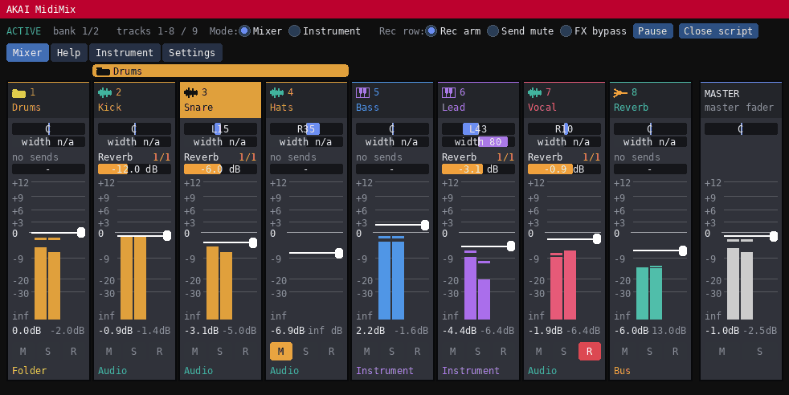
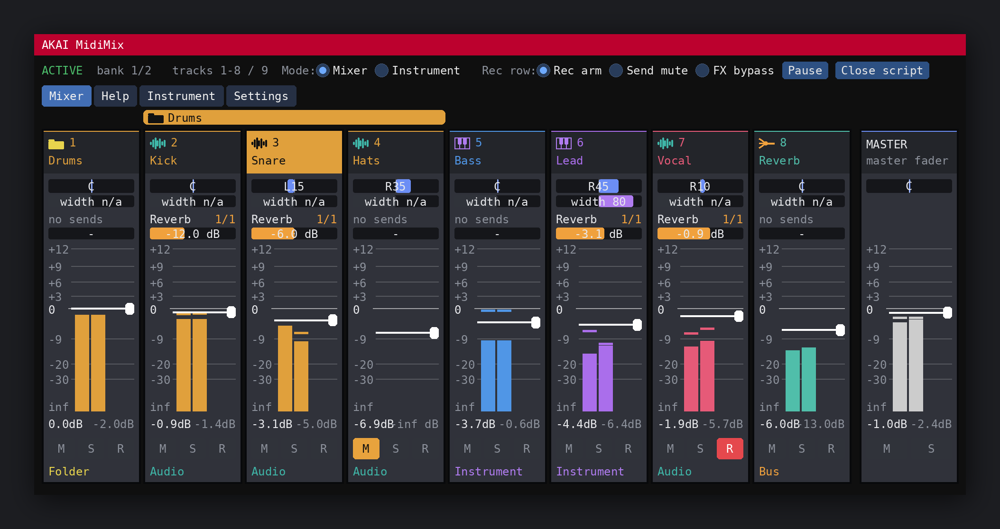
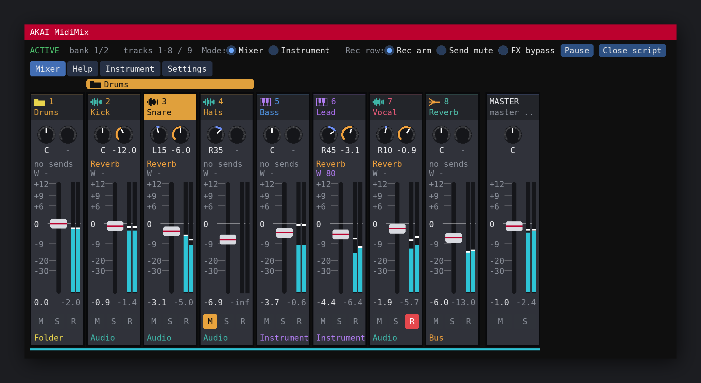

<p align="center">English | <a href="README.ru.md">Русский</a></p>

<h1 align="center">AKAI MidiMix for REAPER</h1>

<p align="center">
Control REAPER with your Akai MIDI Mix.<br>
One Lua script. No ReaLearn, OSC or extra extensions.
</p>

## Quick start

### Recommended: install with ReaPack
1. In REAPER, open Extensions > ReaPack > Import repositories and paste:
   `https://github.com/eighthkeepa/AKAI-MidiMix-for-REAPER/raw/main/index.xml`
2. Open Browse packages, search for “AKAI MidiMix” and install **AKAI MidiMix for REAPER**.
3. To use the window, install **ReaImGui** through ReaPack too.

### Manual install
1. In REAPER, choose Options > Show REAPER resource path and open the `Scripts` folder.
2. Copy the contents of `MIDI/` there: `AKAI MidiMix.lua` and the `midimix/` folder. Keep them together.

### Enable MIDI and start the script
1. In Preferences > MIDI Devices, enable both input and output for the MIDI Mix. Output is needed for the LEDs.
2. If a track uses “All MIDI inputs”, change its input so it doesn't receive notes from the MIDI Mix.
3. Open Actions > Show action list > New action > Load ReaScript, select `AKAI MidiMix.lua` and run it. Add the action to a toolbar if you want a button to start and stop the script.

If a button or LED behaves unexpectedly, run **AKAI MidiMix probe**. It lights the LEDs one at a time and shows the MIDI messages sent by the controller.

<p align="center">
  
</p>

Use the controller's faders, knobs and buttons to control tracks in REAPER. Its LEDs show track states, and the optional window mirrors the mixer layout on screen.

## Mixer controls

**24 knobs, 9 faders and 24 buttons**
- Faders control track volume, up to +12 dB. The Master fader controls the master track.
- The bottom row controls pan, the middle row stereo width, and the top row send levels.
- Each strip has Mute, Solo and Rec controls.
- Soft takeover prevents sudden jumps. Turn a knob until it reaches the parameter's current value; it will then take control.
- Tracks are grouped into banks of up to eight. Bank Left and Bank Right switch banks. Hold either button to jump to the first or last bank. Solo + Bank moves one track at a time.

**Master track**
Hold Bank Right and press Mute or Solo to change the master's state. While holding Bank Right, turn any bottom-row knob to adjust master pan.

**Rec buttons**
The Rec row can arm tracks, mute the send selected in the window, or bypass a track's entire FX chain. Double-tap Solo to switch between these actions.

**Plugin parameters**
In Instrument mode, all 24 knobs control plugin parameters. Select a cell in the window, then adjust a parameter in a plugin on any track or on the master. The script assigns it to the knob and saves the mapping in the project. Mute opens the plugin window; Rec selects the track.

**Track types**
The script detects audio, instrument, bus, VCA, folder and separator tracks. Change a track's type with one click. Separator tracks are skipped by the controller.

**Mark the current bank**
In REAPER, mark the tracks in the current bank with spacers, two red marker tracks or a red tint. The script removes the markers it added when it stops.

**Controller LEDs**
Mute and Rec LEDs show track states in REAPER. Bank LEDs show the current bank and indicate when the script is paused. You can turn off the start-up and exit animations.

## Mixer window

<p align="center">
  
  
</p>

The window uses [ReaImGui](https://github.com/cfillion/reaimgui). You don't need to install it unless you want the window; the controller works without it.

- Choose classic fader strips or round knobs in the MPC 2.0 style.
- Stereo meters hold peak levels and reflect each track's volume and pan.
- A line marks 0 dB. The fader scale follows the maximum value you set.
- The window shows folder bands, track colors and the master strip.
- Help lists the button combinations. Hover over a pan control, fader or button to see a hint.
- Instrument is where you manage plugin mappings; Settings contains the other options.
- The interface is available in English and Russian. The title bar uses Akai Red.

## Button combinations

| Action | How |
|---|---|
| Volume | Faders; Master controls the master track |
| Pan / width / send | Bottom / middle / top row of knobs |
| Mute a track | Mute |
| Arm a track or run the current Rec action | Press Rec; it runs when you release the button |
| Solo one track | Hold Solo and press that strip's Mute |
| Solo the whole bank | Tap Solo; tap it again to restore the previous state |
| Arm the whole bank | Solo + any Rec |
| Clear Solo on all tracks | Solo + Send All |
| Previous / next bank | Bank Left / Bank Right |
| First / last bank | Hold Bank Left or Bank Right for half a second, then release |
| Move by one track | Solo + Bank |
| Master mute / solo / pan | Hold Bank Right and press Mute / Solo, or turn a bottom-row knob |
| Select the next send for one track | Hold its Rec and tap Send All |
| Pause / resume | Double-tap Send All |
| Change the Rec-row action | Double-tap Solo; the second tap also restores the bank's previous Solo state |
| Turn Instrument mode on or off | Tap Send All once |

The Help tab lists the same combinations.

Send All sends a burst of CC messages, not a MIDI note. It can detect single and double taps, but not a hold.

**Pan mode stays as it is by default.** To let the controller switch tracks to stereo pan, enable “Allow switching tracks to stereo pan from the device” in Settings. Then Solo + a middle-row knob switches one track; pressing Bank Left and Bank Right together switches the whole bank. With the option off, the width knob works only on tracks already in stereo pan mode. The window shows “width n/a” for other tracks.

## Settings

Settings are saved in REAPER. To keep them in a separate file, create `midimix_config.lua` next to the script:

```lua
return {
  bank_size = 6,           -- strips per bank (1..8)
  highlight = "color",     -- spacers | markers | color | none
  mixer_style = "mpc",     -- classic | mpc
  language = "en",         -- en | ru
  sends_by_name = true,    -- match sends by destination name
  follow_mixer = true,     -- follow the mixer scroll position
}
```

Default values are listed at the top of `midimix/settings.lua`. Settings saved in the window take precedence over the config file. “Reset to defaults” clears saved settings.

## Notes

- Only Mute, Rec and Bank buttons have LEDs; that's how the controller is built.
- The script reads MIDI about 30 times per second. Fast knob turns may skip values, so turn steadily when mapping a plugin parameter.
- Plugin mappings work with track FX and master FX. Item FX and input FX aren't supported yet.
- The controller can show the first 16 sends on each track. Later sends still work, but their numbers aren't shown.
- The Rec-row action isn't saved between runs. The buttons start in record-arm mode.

## For developers

```
MIDI/AKAI MidiMix.lua         main script
MIDI/midimix/                 modules: settings, lang, device, tracks, instrument, input, gui, highlight
MIDI/AKAI MidiMix probe.lua   hardware probe
tests/                        automated checks: python3 -I tests/run.py   (needs lupa)
                              README images:     python3 -I tests/render_preview.py   (needs lupa, Pillow)
```

All modules share one environment, so `CFG`, `S` and helper functions are available throughout. Add new code to the relevant module. ReaPack tags (`@version`, `@provides`, `@changelog`) are at the top of the main script.

## Credits

Project idea, hardware testing and design decisions: The Eighth.

## License

GPL-3.0-or-later. See [LICENSE](LICENSE).
