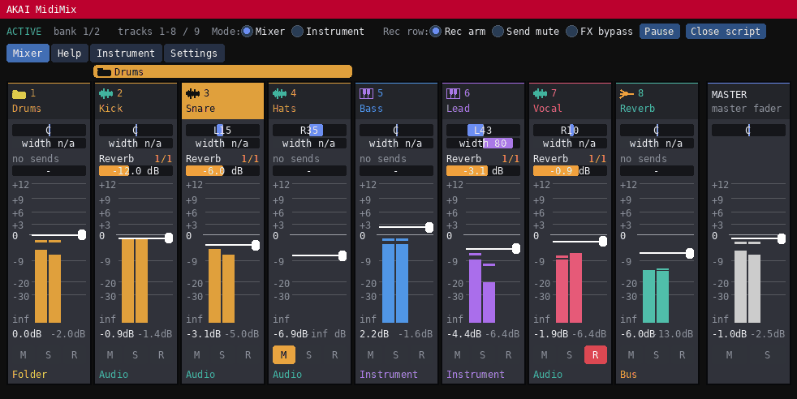
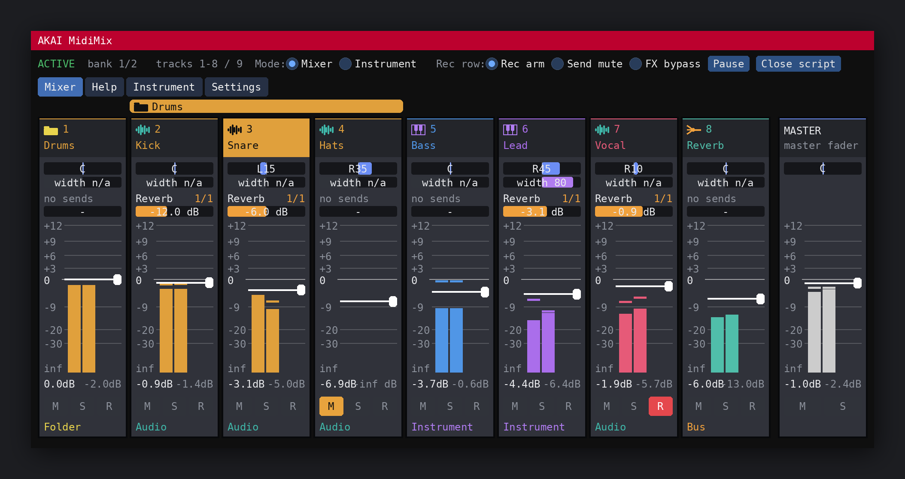
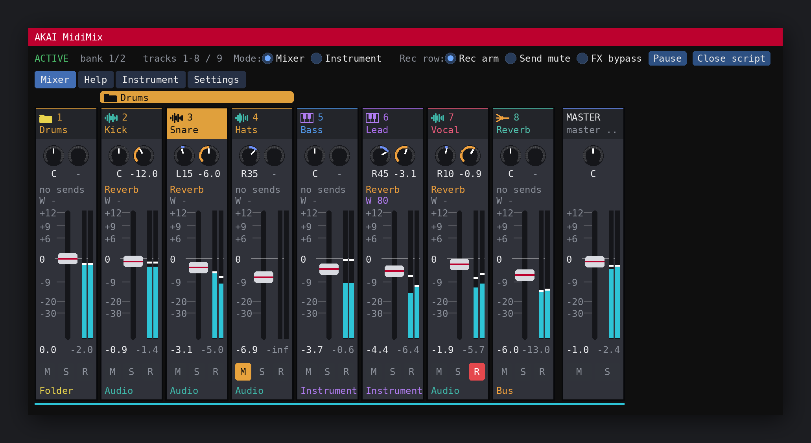

<p align="center"><a href="README.md">English</a> | Русский</p>

<h1 align="center">AKAI MidiMix для REAPER</h1>

<p align="center">
Управляйте REAPER с помощью Akai MIDI Mix.<br>
Один Lua-скрипт — без ReaLearn, OSC и дополнительных расширений.
</p>

## Быстрый старт

### Рекомендуемый способ: ReaPack
1. В REAPER откройте Extensions > ReaPack > Import repositories и вставьте адрес:
   `https://github.com/eighthkeepa/AKAI-MidiMix-for-REAPER/raw/main/index.xml`
2. Откройте Browse packages, найдите «AKAI MidiMix» и установите **AKAI MidiMix for REAPER**.
3. Чтобы открыть окно микшера, установите через ReaPack также **ReaImGui**.

### Установка вручную
1. В REAPER выберите Options > Show REAPER resource path и откройте папку `Scripts`.
2. Скопируйте туда содержимое папки `MIDI/`: файл `AKAI MidiMix.lua` и папку `midimix/`. Они должны лежать рядом.

### Включите MIDI и запустите скрипт
1. В Preferences > MIDI Devices включите вход и выход для MIDI Mix. Выход нужен, чтобы работали диоды.
2. Если дорожка принимает сигнал со всех MIDI-входов (All MIDI inputs), смените её вход. Иначе она будет получать ноты с контроллера.
3. Откройте Actions > Show action list > New action > Load ReaScript, выберите `AKAI MidiMix.lua` и запустите скрипт. Чтобы включать его кнопкой, добавьте действие на панель инструментов.

Если кнопка или диод ведут себя неожиданно, запустите **AKAI MidiMix probe**. Скрипт проверит диоды по очереди и покажет MIDI-сообщения, которые отправляет контроллер.

<p align="center">
  
</p>

Фейдеры, ручки и кнопки контроллера управляют дорожками в REAPER. Диоды показывают их состояние, а окно на экране повторяет раскладку микшера.

## Управление микшером

**24 ручки, 9 фейдеров и 24 кнопки**
- Фейдеры регулируют громкость дорожек. Верхнее положение соответствует +12 дБ. Фейдер Master управляет мастер-дорожкой.
- Нижний ряд ручек отвечает за панораму, средний — за ширину стерео, верхний — за уровень посылов.
- На каждой полосе доступны Mute, Solo и Rec.
- При подхвате (pickup) значение не скачет: поверните ручку до текущего уровня параметра, и она начнёт им управлять.
- Дорожки разделены на банки по восемь. Bank Left и Bank Right переключают банки. Удерживайте одну из кнопок, чтобы перейти к первому или последнему банку. Сочетание Solo + Bank перемещает выбор на одну дорожку.

**Мастер-дорожка**
Удерживайте Bank Right и нажмите Mute или Solo, чтобы изменить состояние мастера. Нижняя ручка при зажатой Bank Right регулирует его панораму.

**Кнопки Rec**
Ряд Rec можно использовать для взведения дорожек на запись, отключения выбранного в окне посыла или обхода всей цепочки эффектов дорожки. Дважды нажмите Solo, чтобы сменить действие ряда.

**Параметры плагинов**
В режиме Instrument все 24 ручки управляют параметрами плагинов. Выберите ячейку в окне, затем измените нужный параметр в плагине на дорожке или мастере. Скрипт назначит его на ручку и сохранит связь в проекте. Кнопка Mute открывает окно плагина, а Rec выбирает дорожку.

**Типы дорожек**
Скрипт распознаёт аудио-, инструментальные, bus-, VCA-, folder- и separator-дорожки. Тип можно изменить вручную одним нажатием. Separator-дорожки контроллер пропускает.

**Выделение текущего банка**
В REAPER текущий банк можно отметить разделителями, двумя красными дорожками-маркерами или красной подкраской. При остановке скрипт удаляет добавленные им метки.

**Диоды контроллера**
Диоды Mute и Rec показывают состояние дорожек в REAPER. Диоды Bank показывают текущий банк и сообщают, что скрипт на паузе. Анимацию при запуске и мигание при выходе можно отключить.

## Окно микшера

<p align="center">
  
  
</p>

Окно работает через [ReaImGui](https://github.com/cfillion/reaimgui). Устанавливать его необязательно: без окна контроллер продолжит работать.

- Доступны два оформления: классические фейдеры и круглые ручки в стиле MPC 2.0.
- Стереометры удерживают пиковое значение и учитывают громкость и панораму дорожки.
- Линия отмечает 0 дБ. Шкала фейдера меняется вместе с выбранным верхним пределом.
- В окне видны папки, цвета дорожек и мастер-дорожка.
- Во вкладке Help перечислены сочетания кнопок. Наведите курсор на регулятор панорамы, фейдер или кнопку — появится подсказка.
- Во вкладке Instrument настраиваются связи с параметрами плагинов, во вкладке Settings — остальные параметры.
- Язык интерфейса можно переключить между русским и английским. Заголовок окна окрашен в Akai Red.

## Сочетания кнопок

| Действие | Как выполнить |
|---|---|
| Громкость | Фейдеры; Master управляет мастер-дорожкой |
| Панорама / ширина / посыл | Нижний / средний / верхний ряд ручек |
| Выключить звук дорожки | Mute |
| Взвести дорожку на запись или выполнить назначенное действие Rec | Нажать Rec; действие срабатывает при отпускании |
| Включить Solo на одной дорожке | Удерживать Solo и нажать Mute на её полосе |
| Включить Solo на всём банке | Коротко нажать Solo; повторное нажатие вернёт прежнее состояние |
| Взвести на запись весь банк | Solo + любая кнопка Rec |
| Снять Solo со всех дорожек | Solo + Send All |
| Перейти к соседнему банку | Bank Left / Bank Right |
| Перейти к первому или последнему банку | Удерживать Bank Left или Bank Right полсекунды, затем отпустить |
| Перейти на одну дорожку | Solo + Bank |
| Управлять Mute / Solo / панорамой мастера | Удерживать Bank Right и нажать Mute / Solo или повернуть нижнюю ручку |
| Выбрать следующий посыл дорожки | Удерживать её Rec и нажать Send All |
| Поставить скрипт на паузу или продолжить работу | Дважды нажать Send All |
| Сменить действие кнопок Rec | Дважды нажать Solo; второе нажатие также возвращает прежнее состояние Solo банка |
| Включить или выключить режим Instrument | Один раз нажать Send All |

Те же сочетания доступны во вкладке **Help**.

Send All отправляет серию CC-сообщений, а не MIDI-ноту. Поэтому распознаются одиночное и двойное нажатия, но не удержание.

**Скрипт не меняет режим панорамы сам.** Чтобы разрешить переключение в stereo pan с контроллера, включите в Settings параметр «Allow switching tracks to stereo pan from the device». Затем сочетание Solo + средняя ручка переключит одну дорожку, а одновременное нажатие Bank Left и Bank Right — весь банк. Если параметр выключен, ширина стерео регулируется только на дорожках, уже работающих в stereo pan. Для остальных окно показывает «width n/a».

## Настройки

Настройки из окна сохраняются в REAPER. Если удобнее хранить их рядом со скриптом, создайте файл `midimix_config.lua`:

```lua
return {
  bank_size = 6,           -- число полос в банке (1..8)
  highlight = "color",     -- spacers | markers | color | none
  mixer_style = "mpc",     -- classic | mpc
  language = "ru",         -- en | ru
  sends_by_name = true,    -- искать посылы по имени получателя
  follow_mixer = true,     -- следовать за прокруткой микшера
}
```

Значения по умолчанию указаны в начале `midimix/settings.lua`. Настройки, сохранённые в окне, имеют приоритет над файлом. Команда «Reset to defaults» сбрасывает сохранённые настройки.

## Что стоит учесть

- Диоды есть только у кнопок Mute, Rec и Bank — так устроен контроллер.
- Скрипт считывает MIDI примерно 30 раз в секунду. При резком повороте ручки некоторые значения могут пропуститься. Для назначения параметра плагина поворачивайте ручку плавно.
- Привязки поддерживают эффекты на дорожках и мастере. Эффекты на отдельных элементах и входные эффекты пока не поддерживаются.
- На контроллере отображаются первые 16 посылов дорожки. Остальные посылы работают, но их номера не показываются.
- Выбранное действие ряда Rec не сохраняется между запусками. При каждом запуске кнопки Rec взводят дорожки на запись.

## Для разработчиков

```
MIDI/AKAI MidiMix.lua         основной скрипт
MIDI/midimix/                 модули: settings, lang, device, tracks, instrument, input, gui, highlight
MIDI/AKAI MidiMix probe.lua   проверка контроллера
tests/                        автоматические проверки: python3 -I tests/run.py   (нужен lupa)
                              изображения для README: python3 -I tests/render_preview.py   (нужны lupa, Pillow)
```

Модули работают в одном окружении: переменные `CFG`, `S` и вспомогательные функции доступны каждому из них. Новый код размещайте в соответствующем модуле. Теги ReaPack (`@version`, `@provides`, `@changelog`) находятся в начале основного скрипта.

## Автор

Идея проекта, проверка на контроллере и ключевые решения — The Eighth.

## Лицензия

GPL-3.0-or-later. См. [LICENSE](LICENSE).
